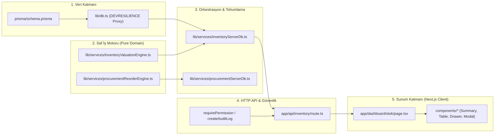
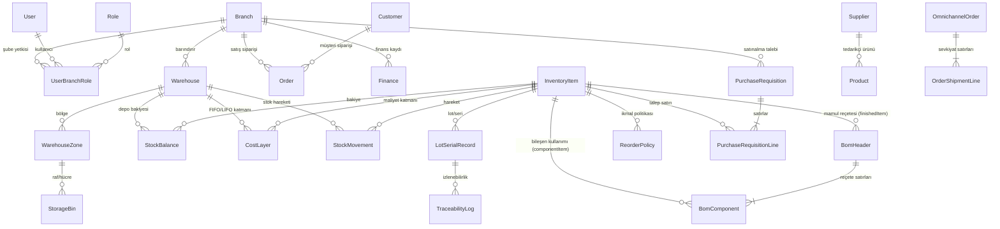

# Sunum ERP (Çiçekana Kurumsal ERP) — Faz 0: Mimari Keşif, Mevcut Sistem Envanteri ve Üretim Modülleri Rehberi

> **Belge Kodu:** `00-kesif-raporu.md`  
> **Durum:** Faz 0 (Salt-Okunur Keşif ve Belgeleme — Tek Satır Uygulama Kodu Değiştirilmemiştir)  
> **Kapsam:** Mevcut teknoloji yığını, katmanlı mimari, tasarım sistemi envanteri, veri modeli (ER), mevcut üretim varlıkları, entegrasyon noktaları, test baz referansı, **Yeni Modül Ekleme Şablonu** ve **Tasarım Kullanım Rehberi**.

---

## 1. Teknoloji Yığını ve Altyapı Mimarisi

### 1.1. Dil, Çalışma Zamanı ve Framework
| Katman | Teknoloji / Kütüphane | Sürüm / Konfigürasyon | Kaynak Dosya |
| :--- | :--- | :--- | :--- |
| **Programlama Dili** | TypeScript | `^5` (`strict: true`, `moduleResolution: "bundler"`, `@/* -> ./*`) | [`tsconfig.json`](file:///c:/Users/!/Desktop/Sunum%20ERP/tsconfig.json) |
| **Full-Stack Framework** | Next.js (App Router) | `^16.4.3` (`next dev --webpack -p 3020`, `next build --webpack`) | [`package.json`](file:///c:/Users/!/Desktop/Sunum%20ERP/package.json), [`next.config.js`](file:///c:/Users/!/Desktop/Sunum%20ERP/next.config.js) |
| **UI Kütüphanesi** | React & React DOM | `19.2.0` (`react-jsx`) | [`package.json`](file:///c:/Users/!/Desktop/Sunum%20ERP/package.json) |
| **Masaüstü Kabuğu** | Electron & Electron Builder | `^31.0.1` / `^26.0.12` + `bytenode` (`^1.5.7` V8 Bytecode derleme) | [`electron/main.js`](file:///c:/Users/!/Desktop/Sunum%20ERP/electron/main.js), [`electron-builder.json`](file:///c:/Users/!/Desktop/Sunum%20ERP/electron-builder.json) |
| **Mikroservis (Yan Servis)** | WhatsApp Connector | Node.js + `@whiskeysockets/baileys` + Docker Compose (Port `3001`) | [`services/wa-connector`](file:///c:/Users/!/Desktop/Sunum%20ERP/services/wa-connector), [`docker-compose.yml`](file:///c:/Users/!/Desktop/Sunum%20ERP/docker-compose.yml) |

### 1.2. Veritabanı, ORM ve Hibrit `DEVRESILIENCE` Mimarisi
Sistem, hem bulut/sunucu (PostgreSQL) hem de çevrimdışı/masaüstü (Electron / yerel geliştirme) ortamlarında kesintisiz çalışabilmek için **3 katmanlı hibrit bir veri erişim mimarisi** kullanır:

1. **Birincil ORM ve Veritabanı (PostgreSQL + Prisma `^5.22.0`):**
   - Şema tanımı [`prisma/schema.prisma`](file:///c:/Users/!/Desktop/Sunum%20ERP/prisma/schema.prisma) dosyasındadır (`provider = "postgresql"`, `url = env("DATABASE_URL")`).
   - Toplam **2.711 satır** ve **88 model** içerir.
2. **Yerel JSON Veritabanı Yedekleme Motoru (`DEVRESILIENCE` — [`lib/db.ts`](file:///c:/Users/!/Desktop/Sunum%20ERP/lib/db.ts)):**
   - `export const prisma = new Proxy(rawPrisma, ...)` yapısı tüm Prisma model çağrılarını (`findMany`, `findUnique`, `findFirst`, `create`, `update`, `updateMany`, `upsert`, `delete`, `deleteMany`, `count`, `groupBy`, `aggregate`) yakalar.
   - PostgreSQL sunucusuna ulaşılamadığında (`P1001`, `ECONNREFUSED`, `Can't reach database server`) veya ilgili tablo henüz veritabanında yoksa otomatik olarak [`ModelSimulate`](file:///c:/Users/!/Desktop/Sunum%20ERP/lib/db.ts#L504-L1150) sınıfına düşer ve verileri [`storage/ajans-kutuphanesi/.local-db.json`](file:///c:/Users/!/Desktop/Sunum%20ERP/storage/ajans-kutuphanesi/.local-db.json) dosyası üzerinde okur/yazar.
   - **Kritik Mimari Kural:** `ModelSimulate` etkileşimli `prisma.$transaction(async (tx) => ...)` callback yapısını simüle etmez; bu nedenle servis katmanındaki çok adımlı işlemler (`inventoryServerDb.ts`, `wmsServerDb.ts`, `procurementServerDb.ts`) sıralı `(prisma as any).modelAdi.create/update` çağrılarıyla yazılmıştır.
3. **Demo / Sunum Veri Denetleyicisi ([`lib/data-controller.ts`](file:///c:/Users/!/Desktop/Sunum%20ERP/lib/data-controller.ts)):**
   - Eski/çekirdek modüller (`orders`, `finance`, `customers`, `products`, `leads`) `isDemoModeActive()` (`DISABLE_DEMO_MODE="true"` veya `ENABLE_DEMO_MODE="false"` değilse varsayılan `true`) kontrolüyle [`lib/data/mockDatabase.ts`](file:///c:/Users/!/Desktop/Sunum%20ERP/lib/data/mockDatabase.ts) üzerinden bellek içi örnek veri dönebilir.
   - Yeni nesil Kurumsal ERP modülleri (`stok`, `wms`, `satinalma`, `omnichannel`) ise doğrudan `prisma` (`lib/db.ts`) üzerinden çalışır ve ilk çalışmada `ensure...DbSeeded()` fonksiyonlarıyla veritabanını (veya `.local-db.json` dosyasını) gerçekçi başlangıç verileriyle otomatik tohumlar (seed eder).

### 1.3. Migration Aracı ve Mevcut Durum
- **Araç:** Prisma Migrate (`prisma/migrations/` altında zaman damgalı klasörler içinde ham `migration.sql` dosyaları).
- **Mevcut Migration Listesi:**
  1. `20260303064526_init_postgres`
  2. `20260303071528_update_schema`
  3. `20260319000000_agency_paradigm_shift`
  4. `20260322000000_freelancer_hub`
  5. `20260322150000_SocialMediaPost`
  6. `20260322183000_media_production_hub`
  7. `20260720_whatsapp_baileys`
  8. `20260721_ai_whatsapp_agent`
- **Önemli Bulgu:** `prisma/schema.prisma` içindeki Faz 1–6 Kurumsal Stok/WMS/Satınalma/Omnichannel/Finansal Uyum modelleri (`Warehouse`, `InventoryItem`, `BomHeader`, `BomComponent`, `StockMovement`, `PurchaseRequisition`, vb.) şemada ve `lib/db.ts` içinde tam tanımlıdır; ancak `prisma/migrations/` altında henüz ayrı bir SQL migration klasörleri yoktur (`prisma db push` ve `DEVRESILIENCE` JSON motoru ile çalıştırılmaktadır). Yeni eklenecek üretim fazlarında hem `prisma/schema.prisma` güncellenecek hem de geri alınabilir (`migration.sql` + `rollback.sql`) dosyalar üretilecektir.

### 1.4. Frontend State Yönetimi ve Veri Akışı
- Harici bir global state kütüphanesi (Redux/Zustand) **kullanılmamaktadır**.
- **Global Bağlamlar (React Context):**
  - [`AuthProvider` / `useAuth()`](file:///c:/Users/!/Desktop/Sunum%20ERP/lib/auth/context.tsx): Kullanıcı oturumu (`session`), aktif şube (`currentBranch`), şube değiştirme (`setCurrentBranch` — `localStorage.getItem("activeBranchId")`), yetki kontrolü (`hasPermission(resource, action)`).
  - [`ThemeProvider`](file:///c:/Users/!/Desktop/Sunum%20ERP/components/theme-provider.tsx): `next-themes` tabanlı koyu tema (`defaultTheme="dark"`).
- **Sayfa İçi State Kalıbı:** Sayfa bileşenleri (`"use client"`) `useState`, `useMemo`, `useCallback`, `useEffect` kullanarak ilk yüklemede `fetch("/api/<modul>?section=snapshot")` ile tüm modül özetini (`snapshot`) çeker; filtreleme, arama ve sıralamayı `useMemo` ile anlık yapar; mutasyon sonrası (`POST /api/<modul>`) `toast.success(...)` gösterip `fetchSnapshot()` ile veriyi tazeler.

### 1.5. Build ve Dağıtım (Deploy) Altyapısı
- [`next.config.js`](file:///c:/Users/!/Desktop/Sunum%20ERP/next.config.js): `process.env.VERCEL ? undefined : 'standalone'` çıktısı üretir. `typescript.ignoreBuildErrors: true` ayarı mevcuttur (ancak biz tüm fazlarda `npx tsc --noEmit` ile tip güvenliğini doğrulayacağız).
- **Komutlar (`package.json`):**
  - `npm run dev`: Port `3020` üzerinde geliştirme sunucusu.
  - `npm run build`: `prisma generate && next build --webpack`.
  - `npm run dist:win`: Prisma üretim + Next build + `scripts/obfuscate-electron.js` (`javascript-obfuscator` + `bytenode` `.jsc` derlemesi) + `electron-builder --win`.

### 1.6. Kimlik Doğrulama, Çoklu Şube RBAC ve Güvenlik Modeli
1. **Oturum (JWT + DB):**
   - Giriş başarılı olduğunda `jose` ile imzalanan HS256 JWT token `auth-token` çerezine (cookie) yazılır ve [`UserSession`](file:///c:/Users/!/Desktop/Sunum%20ERP/prisma/schema.prisma#L120-L133) tablosunda saklanır.
   - [`getAuthPayload()`](file:///c:/Users/!/Desktop/Sunum%20ERP/lib/auth/server-permission.ts#L16-L86): Çerezdeki JWT'yi doğrular, `UserSession` tablosundan oturumun iptal edilmediğini (`expiresAt > now`) ve kullanıcının aktif olduğunu (`isActive === true`) kontrol eder.
   - **Geliştirme Modu İstisnası:** `NODE_ENV !== "production"` iken `userId === "local-debug-user"` (`branchId: "local-debug-branch"`) oturumu veritabanı sorgusu yapmadan `Super Admin` yetkisiyle kabul edilir.
2. **Çoklu Şube Yetkilendirme (Multi-Branch RBAC):**
   - Kullanıcılar şubelere [`UserBranchRole`](file:///c:/Users/!/Desktop/Sunum%20ERP/prisma/schema.prisma#L106-L118) (`userId`, `branchId`, `roleId`) üzerinden atanır.
   - [`Role`](file:///c:/Users/!/Desktop/Sunum%20ERP/prisma/schema.prisma#L93-L104) tablosundaki `permissions` alanı JSON string formatında kaynak ve aksiyon dizilerini tutar (Örn: `{"inventory": ["read", "create", "update", "delete", "approve"]}`).
   - [`lib/auth/permissions.ts`](file:///c:/Users/!/Desktop/Sunum%20ERP/lib/auth/permissions.ts): Türkçe/İngilizce kaynak takma adlarını (`RESOURCE_ALIASES`) normalize eder ve `DEFAULT_ROLES` (`Super Admin`, `Platform Developer`, `Genel Müdür`, `Şube Müdürü`, `Finans Müdürü`, `İK Uzmanı`, `Satış Temsilcisi`, `Operasyon Personeli`, `Personel`) yetki matrisini tanımlar.
   - **Sunucu Tarafı Guard:** API rotalarında [`requirePermission(resource, action, branchId)`](file:///c:/Users/!/Desktop/Sunum%20ERP/lib/auth/server-permission.ts#L121-L163) çağrılır. Yetkisiz erişimde `401 Unauthorized` veya `403 Forbidden` `NextResponse` döner.
3. **Kurumsal API Guard ve Lisans/Bütünlük Koruması ([`lib/auth/api-guard.ts`](file:///c:/Users/!/Desktop/Sunum%20ERP/lib/auth/api-guard.ts)):**
   - İstemci isteklerinde `x-cicekana-Integrity`, `x-cicekana-Timestamp`, `x-cicekana-Nonce` HMAC-SHA256 başlıklarını ([`lib/auth/integrity.ts`](file:///c:/Users/!/Desktop/Sunum%20ERP/lib/auth/integrity.ts)) ve donanım/domain lisans parmak izini doğrular.
   - [`storage/TEST_MODE`](file:///c:/Users/!/Desktop/Sunum%20ERP/lib/system-config.ts#L142-L153) dosyası mevcutsa veya geliştirme ortamındaysa karantina kilidi devre dışı bırakılır.
4. **Denetim Logu (Audit Log) ve Geri Dönüşüm Kutusu (Soft-Delete):**
   - Tüm kritik mutasyonlar [`createAuditLog({ userId, action, resource, resourceId, details })`](file:///c:/Users/!/Desktop/Sunum%20ERP/lib/audit.ts) ile [`AuditLog`](file:///c:/Users/!/Desktop/Sunum%20ERP/prisma/schema.prisma#L151-L165) tablosuna kaydedilir.
   - Silme işlemleri doğrudan yok etmek yerine [`TrashService.moveToTrash(...)`](file:///c:/Users/!/Desktop/Sunum%20ERP/lib/trash/trash-service.ts) ile [`TrashItem`](file:///c:/Users/!/Desktop/Sunum%20ERP/prisma/schema.prisma#L1697-L1716) tablosuna ve `storage/trash_quarantine/` dizinine taşınabilir.

---

## 2. Klasör & Katman Mimarisi ve "Yeni Modül Ekleme Şablonu"

### 2.1. Üst Düzey Klasör Yapısı
```text
Sunum ERP/
├── app/
│   ├── api/                        # Next.js Route Handlers (REST API katmanı)
│   │   ├── inventory/route.ts      # Faz 1: Stok, Maliyet Katmanları ve BOM API
│   │   ├── wms/route.ts            # Faz 2: Depo İçi (WMS) Direktif ve Rotalama API
│   │   ├── procurement/route.ts    # Faz 3: Satınalma, ROP ve Konsinye API
│   │   ├── omnichannel/route.ts    # Faz 4: Omnichannel, ATP, B2B ve RMA API
│   │   ├── finance/route.ts        # Finans / Gelir-Gider API
│   │   └── orders/route.ts         # Çekirdek Sipariş API
│   ├── dashboard/                  # Korumalı ERP Arayüz Ekranları (App Router)
│   │   ├── layout.tsx              # Ana Sidebar, Üst Bar, Şube Seçici, Bildirimler
│   │   ├── stok/                   # Stok & Malzeme + BOM Ekranı ve Bileşenleri
│   │   ├── wms/                    # WMS & Depo Haritası Ekranı
│   │   ├── satinalma/              # Satınalma & İkmal Ekranı
│   │   └── omnichannel/            # Omnichannel & Dağıtım Ekranı
│   ├── globals.css                 # Obsidian Carbon & Emerald Mint Tasarım Tokenları
│   └── layout.tsx                  # Kök HTML/Font/Theme/Auth/Toaster Sarmalayıcı
├── components/
│   └── ui/                         # 56 adet shadcn/ui + Radix + Framer Motion bileşeni
├── lib/
│   ├── auth/                       # JWT, RBAC, Permissions, API Guard, Integrity
│   ├── notifications/              # Bildirim Kataloğu, Sanitizer ve Banner/Toast Servisi
│   ├── services/                   # İş Mantığı Motorları (*Engine.ts) ve DB Katmanı (*ServerDb.ts)
│   ├── trash/                      # Polimorfik Geri Dönüşüm Kutusu (TrashService)
│   ├── audit.ts                    # Denetim Logu (createAuditLog)
│   ├── db.ts                       # Prisma Client + DEVRESILIENCE JSON DB Proxy
│   └── system-config.ts            # Sistem, Firma, Abonelik ve Modül Ayarları
├── prisma/
│   ├── schema.prisma               # PostgreSQL Veri Modeli (88 Tablo)
│   └── migrations/                 # SQL Migration Dosyaları
└── scripts/                        # Doğrulama, Test, Seed ve Build Betikleri
```

### 2.2. Olgun Modülün Uçtan Uca Akışı (Referans: `Stok & Satınalma` Modülleri)
Sistemdeki en olgun ve kurumsal mimariye sahip modüller **Faz 1–3 (`stok`, `wms`, `satinalma`)** modülleridir. Bu modüller 5 net katmandan oluşur:



1. **Katman 1 — Veri Şeması ve Proxy ([`prisma/schema.prisma`](file:///c:/Users/!/Desktop/Sunum%20ERP/prisma/schema.prisma) & [`lib/db.ts`](file:///c:/Users/!/Desktop/Sunum%20ERP/lib/db.ts)):**
   - Tablolar Prisma şemasında tanımlanır ve `lib/db.ts` içindeki `JsonDbData`, `initialData`, `enrichItem`, `fallbackModels` listelerine eklenir.
2. **Katman 2 — Saf İş Mantığı Motoru ([`lib/services/inventoryValuationEngine.ts`](file:///c:/Users/!/Desktop/Sunum%20ERP/lib/services/inventoryValuationEngine.ts)):**
   - **Veritabanı bağımlılığı yoktur (Pure TypeScript).** Tüm tipler (`InventoryItemRecord`, `BomHeaderRecord`, `BomRollupCostResult`), sabitler (`VALUATION_METHOD_LABELS`), birim dönüşüm fonksiyonları (`convertToBaseUnit`), FIFO/LIFO katman tüketim algoritmaları (`consumeCostLayers`) ve reçete maliyet hesaplamaları (`calculateBomRollupCost`) burada yer alır. Doğrudan birim testine (unit test) uygundur.
3. **Katman 3 — Veritabanı Orkestrasyon ve Seed Servisi ([`lib/services/inventoryServerDb.ts`](file:///c:/Users/!/Desktop/Sunum%20ERP/lib/services/inventoryServerDb.ts)):**
   - `ensureInventoryDbSeeded()`: Tablolar boşsa başlangıç verilerini (depolar, stok kartları, bakiye, maliyet katmanları, BOM reçeteleri) oluşturur.
   - `getEnterpriseInventorySnapshotFromDb()`: Tek çağrıda ekranın ihtiyaç duyduğu tüm ilişkisel verileri çekip Saf İş Motoru tiplerine dönüştürür ve KPI özetlerini hesaplar.
   - Mutasyon fonksiyonları (`executeStockMovementInDb`, `createInventoryItemInDb`): Sıralı Prisma işlemleriyle veritabanını günceller.
4. **Katman 4 — API Route Handler ([`app/api/inventory/route.ts`](file:///c:/Users/!/Desktop/Sunum%20ERP/app/api/inventory/route.ts)):**
   - `GET`: `searchParams.get("section")` parametresine göre (`snapshot`, `kpis`, `items`, `bom`, `abc_xyz`, `turnover`, `traceability`, `count_sheets`) ilgili servis fonksiyonunu çağırır.
   - `POST`: `body.action` parametresine göre (`stock_movement`, `create_item`, `update_item`, `delete_item`, `bulk_price_update`, `reconcile_count`) girdi doğrulaması yapar ve servisi çalıştırır.
5. **Katman 5 — Arayüz Ekranı ve Bileşenleri ([`app/dashboard/stok/page.tsx`](file:///c:/Users/!/Desktop/Sunum%20ERP/app/dashboard/stok/page.tsx)):**
   - Üstte [`InventoryModuleNav`](file:///c:/Users/!/Desktop/Sunum%20ERP/app/dashboard/stok/components/InventoryModuleNav.tsx), altında başlık ve aksiyon butonları, 4'lü KPI şeridi ([`StockSummaryCards`](file:///c:/Users/!/Desktop/Sunum%20ERP/app/dashboard/stok/components/StockSummaryCards.tsx)), sekme + filtre + 6 sütunlu tablo ([`StockTable`](file:///c:/Users/!/Desktop/Sunum%20ERP/app/dashboard/stok/components/StockTable.tsx)), sağdan açılan detay çekmecesi ([`ItemDetailDrawer`](file:///c:/Users/!/Desktop/Sunum%20ERP/app/dashboard/stok/components/ItemDetailDrawer.tsx)) ve aksiyon modalları ([`CreateItemModal`](file:///c:/Users/!/Desktop/Sunum%20ERP/app/dashboard/stok/components/CreateItemModal.tsx)).

---

### 2.3. YENİ MODÜL EKLEME ŞABLONU (Sonraki Fazlar İçin Zorunlu Uygulama Rehberi)

Üretim modüllerinin her fazında yeni bir alt modül veya özellik eklenirken aşağıdaki **9 adımlı standart şablon** eksiksiz uygulanacaktır:

#### Adım 1: Veritabanı Şeması ve Geri Alınabilir (Additive) Migration
1. [`prisma/schema.prisma`](file:///c:/Users/!/Desktop/Sunum%20ERP/prisma/schema.prisma) dosyasına yalnızca **ekleme yapan (additive)** yeni modeller veya opsiyonel alanlar/ilişkiler eklenir. Mevcut hiçbir kolon silinmez, yeniden adlandırılmaz veya tipi değiştirilmez.
2. `prisma/migrations/<YYYYMMDDHHMMSS>_uretim_<faz_adi>/migration.sql` dosyası oluşturulur (`CREATE TABLE IF NOT EXISTS`, `CREATE INDEX IF NOT EXISTS`, `ALTER TABLE ... ADD COLUMN IF NOT EXISTS`).
3. Aynı klasöre geri alma adımlarını içeren `rollback.sql` dosyası yazılır (`DROP TABLE IF EXISTS`, `ALTER TABLE ... DROP COLUMN IF EXISTS`).

#### Adım 2: `lib/db.ts` (`DEVRESILIENCE`) Kaydı
Yeni eklenen her Prisma modeli için [`lib/db.ts`](file:///c:/Users/!/Desktop/Sunum%20ERP/lib/db.ts) içinde şu 4 nokta cerrahi olarak güncellenir:
1. [`JsonDbData`](file:///c:/Users/!/Desktop/Sunum%20ERP/lib/db.ts#L31-L122) arayüzüne `yeniModelAdi: any[]` eklenir.
2. [`initialData`](file:///c:/Users/!/Desktop/Sunum%20ERP/lib/db.ts#L124-L215) nesnesine `yeniModelAdi: []` eklenir.
3. [`enrichItem`](file:///c:/Users/!/Desktop/Sunum%20ERP/lib/db.ts#L283-L502) metoduna `include` ilişkilerini çözen blok eklenir.
4. [`fallbackModels`](file:///c:/Users/!/Desktop/Sunum%20ERP/lib/db.ts#L1218-L1308) dizisine `'yeniModelAdi'` eklenir.

#### Adım 3: Saf İş Mantığı Motoru (`lib/services/production<Faz>Engine.ts`)
- Veritabanından bağımsız, saf TypeScript veri yapıları, durum makineleri (state machine), doğrulama kuralları ve hesaplama fonksiyonları (örn. MRP net ihtiyaç hesabı, iş emri kapasite/termin hesabı, fire/verimlilik hesabı) bu dosyada yazılır.
- Tüm etiket sözlükleri Türkçe olarak dışa aktarılır.

#### Adım 4: Veritabanı Orkestrasyon Katmanı (`lib/services/production<Faz>ServerDb.ts`)
- `ensureProductionDbSeeded()`: İlk çalışmada gerekli varsayılan kayıtları idempotent olarak oluşturur.
- `getProductionSnapshotFromDb(params)`: Sayfalama (`page`, `pageSize`), filtreleme (`branchId`, `status`, `search`) ve ilişkisel verileri tek seferde (N+1 sorgu olmadan, `Promise.all` ve `Map` indeksleme ile) yükler.
- Mutasyon fonksiyonları: Etkileşimli `$transaction` yerine `DEVRESILIENCE` uyumlu sıralı Prisma işlemleri ve hata durumunda telafi edici (compensating) geri alma mantığı kullanır.

#### Adım 5: Yetki (RBAC) ve Özellik Bayrağı (Feature Flag) Kaydı
1. [`lib/auth/permissions.ts`](file:///c:/Users/!/Desktop/Sunum%20ERP/lib/auth/permissions.ts):
   - `RESOURCE_ALIASES` içine `"uretim": "production"`, `"production": "production"`, `"is_emirleri": "production"`, `"mrp": "production"` eklenir.
   - `DEFAULT_ROLES` içinde ilgili rollere (`Genel Müdür`, `Şube Müdürü`, `Operasyon Personeli`) `production` yetkileri tanımlanır.
2. **Özellik Bayrağı (Feature Flag):**
   - [`lib/system-config.ts`](file:///c:/Users/!/Desktop/Sunum%20ERP/lib/system-config.ts) içindeki `ModuleSettingsConfig` arayüzüne opsiyonel bayraklar (örn. `productionModuleEnabled?: boolean`) eklenir ve ortam değişkeni (`NEXT_PUBLIC_FEATURE_PRODUCTION_ENABLED`) ile desteklenir. Bayrak kapalıyken menü ve uç noktalar mevcut sistem davranışını birebir korur.

#### Adım 6: Sunucu API Uç Noktası (`app/api/production/route.ts`)
- Tüm `GET`, `POST`, `PUT`, `DELETE` işleyicilerinde:
  1. Özellik bayrağı kontrolü yapılır.
  2. `await requirePermission("production", action, branchId)` ile sunucu tarafı yetki kontrolü yapılır.
  3. Girdi doğrulaması (zorunlu alanlar, sayısal sınırlar, durum geçiş kuralları) yapılır.
  4. Servis fonksiyonu çağrılır.
  5. [`createAuditLog`](file:///c:/Users/!/Desktop/Sunum%20ERP/lib/audit.ts) ile işlem kayıt altına alınır.
  6. Standart JSON yanıtı (`{ success: true, ... }` veya `{ error: "Türkçe hata mesajı" }`) döndürülür.

#### Adım 7: Arayüz Ekranı ve Bileşenler (`app/dashboard/uretim/...` veya `app/dashboard/stok/...`)
- Tasarım Kullanım Rehberi'ndeki (Bölüm 3) bileşen yapısına %100 sadık kalınarak:
  - `page.tsx`
  - `components/<Modul>SummaryCards.tsx`
  - `components/<Modul>Table.tsx`
  - `components/<Modul>DetailDrawer.tsx`
  - `components/Create<Nesne>Modal.tsx`
  oluşturulur.

#### Adım 8: Navigasyon Kaydı
- [`app/dashboard/stok/components/InventoryModuleNav.tsx`](file:///c:/Users/!/Desktop/Sunum%20ERP/app/dashboard/stok/components/InventoryModuleNav.tsx) içindeki `MODULE_TABS` dizisine ve/veya [`app/dashboard/layout.tsx`](file:///c:/Users/!/Desktop/Sunum%20ERP/app/dashboard/layout.tsx) içindeki `rawCategories` (`id: "stok"`) menüsüne özellik bayrağı kontrolüyle sekme/menü öğesi eklenir.

#### Adım 9: Otomatik Testler (Birim + Entegrasyon + Regresyon)
- Saf motor fonksiyonları için birim testleri ve API/DB akışı için entegrasyon testleri `scripts/test-uretim-<faz>.ts` altında yazılır ve çalıştırılır.

---

## 3. Tasarım Sistemi Envanteri ve "Tasarım Kullanım Rehberi"

### 3.1. Tasarım Dili: "Obsidian Carbon & Emerald Mint"
Sunum ERP, yüksek kontrastlı, göz yormayan, derin karbon zeminler üzerinde zümrüt yeşili (`#34D399`) vurgu rengine dayanan kurumsal bir koyu tema (**Obsidian Carbon & Emerald Mint**) kullanır. Tüm CSS değişkenleri ve yardımcı sınıflar [`app/globals.css`](file:///c:/Users/!/Desktop/Sunum%20ERP/app/globals.css) içinde tanımlıdır.

#### Renk ve Yüzey Tokenları
| Kullanım Amacı | CSS Değişkeni / Tailwind Sınıfı | HEX / RGBA Değeri |
| :--- | :--- | :--- |
| **Ana Sayfa Zemini** | `bg-background` / `--background` | `#080A09` (`150 11% 3.5%`) + sağ üst `%5` zümrüt radyal ışıma |
| **Kart / Panel Yüzeyi** | `.glass-panel`, `.glass-card` | `rgba(17, 21, 19, 0.90)` (`#111513`) + `backdrop-blur-xl` |
| **Tablo Kapsayıcı Yüzeyi** | `.glass-table-container` | `rgba(17, 21, 19, 0.70)` + `border-white/[0.06]` + `rounded-2xl` |
| **Girdi (Input) Yüzeyi** | `.glass-input` | `rgba(255, 255, 255, 0.03)`, odaklanınca `border-emerald-500/40` |
| **Birincil Vurgu (Primary)** | `bg-emerald-500`, `text-emerald-400`, `.btn-primary-emerald` | `#34D399` (Emerald 400) / `#10B981` (Emerald 500), metin `#061811` |
| **Olumlu / Aktif / Tamamlandı** | `.badge-positive` | Zemin `rgba(16, 185, 129, 0.1)`, metin `#34D399`, kenarlık `%20` |
| **Uyarı / Bekleyen / Kritik Stok** | `.badge-pending` | Zemin `rgba(245, 158, 11, 0.1)`, metin `#FBBF24` (Amber 400) |
| **Tehlike / Hata / Stok Yok** | `.badge-critical` | Zemin `rgba(244, 63, 94, 0.1)`, metin `#FB7185` (Rose 400) |
| **Bilgi / Operasyonel** | `bg-cyan-500/10 text-cyan-300 border-cyan-500/20` | Cyan 300/400 veya Violet 300/400 (üretim/atölye vurguları için) |
| **İnce Kenarlıklar** | `border-white/[0.06]` veya `border-white/[0.08]` | `rgba(255, 255, 255, 0.06)` |
| **Köşe Yuvarlatma** | `--radius: 1.25rem` | Kartlarda `rounded-2xl` (`16px`) veya `rounded-[20px]`, butonlarda `rounded-xl` |

### 3.2. Tipografi ve Formatlama Kuralları
1. **Yazı Tipi:** [`app/layout.tsx`](file:///c:/Users/!/Desktop/Sunum%20ERP/app/layout.tsx) içinde Google Fonts `Inter` yüklenir.
2. **Başlıklar ve KPI Değerleri (`font-light` Kuralı):**
   - `app/globals.css` içinde `h1`, `.text-display`, `.kpi-value` sınıfları **`font-weight: 300 !important` (`font-light`)**, `letter-spacing: -0.025em` (`tracking-tight`) ve `font-variant-numeric: tabular-nums` kullanır.
   - Büyük KPI rakamlarında [`<AnimatedNumber value={...} formatFn={...} />`](file:///c:/Users/!/Desktop/Sunum%20ERP/components/ui/motion-primitives.tsx#L105-L133) bileşeni kullanılır.
3. **Etiketler (Micro-Labels):**
   - Bölüm ve metrik üst başlıkları: `text-[11px] font-medium uppercase tracking-wider text-zinc-500`.
4. **Teknik Kodlar (`font-mono`):**
   - Stok kodu (SKU), reçete kodu (`BOM-...`), iş emri numarası (`WO-...`), lot/seri numarası, raf adresi ve parasal birim maliyetler `font-mono` sınıfıyla yazılır.
5. **Türkçe Dil, Para, Sayı ve Tarih Formatı:**
   - **Para Birimi:** `new Intl.NumberFormat("tr-TR", { style: "currency", currency: "TRY", maximumFractionDigits: 2 }).format(val)` (Örn: `₺12.450,00`).
   - **Miktar / Sayı:** `val.toLocaleString("tr-TR")` + birim etiketi (`Adet`, `Dal`, `Metre`, `Kg`, `Demet`).
   - **Tarih / Saat:** `new Date(iso).toLocaleDateString("tr-TR")` (`GG.AA.YYYY`) veya `toLocaleString("tr-TR")`.

### 3.3. Ortak UI Bileşenleri Envanteri (`components/ui/*`)
Sistemde `shadcn/ui` (`new-york` stili, Radix UI tabanlı) bileşen seti yer alır. Yeni ekranlarda **kesinlikle yeni bir UI kütüphanesi eklenmeyecek**, aşağıdaki mevcut bileşenler kullanılacaktır:
- **Layout & Katmanlar:** [`dialog.tsx`](file:///c:/Users/!/Desktop/Sunum%20ERP/components/ui/dialog.tsx), [`sheet.tsx`](file:///c:/Users/!/Desktop/Sunum%20ERP/components/ui/sheet.tsx), [`drawer.tsx`](file:///c:/Users/!/Desktop/Sunum%20ERP/components/ui/drawer.tsx), [`tabs.tsx`](file:///c:/Users/!/Desktop/Sunum%20ERP/components/ui/tabs.tsx), [`accordion.tsx`](file:///c:/Users/!/Desktop/Sunum%20ERP/components/ui/accordion.tsx), [`collapsible.tsx`](file:///c:/Users/!/Desktop/Sunum%20ERP/components/ui/collapsible.tsx), [`scroll-area.tsx`](file:///c:/Users/!/Desktop/Sunum%20ERP/components/ui/scroll-area.tsx), [`separator.tsx`](file:///c:/Users/!/Desktop/Sunum%20ERP/components/ui/separator.tsx), [`card.tsx`](file:///c:/Users/!/Desktop/Sunum%20ERP/components/ui/card.tsx)
- **Form & Girdi:** [`button.tsx`](file:///c:/Users/!/Desktop/Sunum%20ERP/components/ui/button.tsx), [`input.tsx`](file:///c:/Users/!/Desktop/Sunum%20ERP/components/ui/input.tsx), [`textarea.tsx`](file:///c:/Users/!/Desktop/Sunum%20ERP/components/ui/textarea.tsx), [`select.tsx`](file:///c:/Users/!/Desktop/Sunum%20ERP/components/ui/select.tsx), [`checkbox.tsx`](file:///c:/Users/!/Desktop/Sunum%20ERP/components/ui/checkbox.tsx), [`switch.tsx`](file:///c:/Users/!/Desktop/Sunum%20ERP/components/ui/switch.tsx), [`radio-group.tsx`](file:///c:/Users/!/Desktop/Sunum%20ERP/components/ui/radio-group.tsx), [`slider.tsx`](file:///c:/Users/!/Desktop/Sunum%20ERP/components/ui/slider.tsx), [`calendar.tsx`](file:///c:/Users/!/Desktop/Sunum%20ERP/components/ui/calendar.tsx), [`label.tsx`](file:///c:/Users/!/Desktop/Sunum%20ERP/components/ui/label.tsx), [`form.tsx`](file:///c:/Users/!/Desktop/Sunum%20ERP/components/ui/form.tsx)
- **Veri Gösterimi & Geri Bildirim:** [`table.tsx`](file:///c:/Users/!/Desktop/Sunum%20ERP/components/ui/table.tsx), [`badge.tsx`](file:///c:/Users/!/Desktop/Sunum%20ERP/components/ui/badge.tsx), [`progress.tsx`](file:///c:/Users/!/Desktop/Sunum%20ERP/components/ui/progress.tsx), [`skeleton.tsx`](file:///c:/Users/!/Desktop/Sunum%20ERP/components/ui/skeleton.tsx), [`tooltip.tsx`](file:///c:/Users/!/Desktop/Sunum%20ERP/components/ui/tooltip.tsx), [`popover.tsx`](file:///c:/Users/!/Desktop/Sunum%20ERP/components/ui/popover.tsx), [`dropdown-menu.tsx`](file:///c:/Users/!/Desktop/Sunum%20ERP/components/ui/dropdown-menu.tsx), [`command.tsx`](file:///c:/Users/!/Desktop/Sunum%20ERP/components/ui/command.tsx), [`alert-dialog.tsx`](file:///c:/Users/!/Desktop/Sunum%20ERP/components/ui/alert-dialog.tsx), [`sonner.tsx`](file:///c:/Users/!/Desktop/Sunum%20ERP/components/ui/sonner.tsx)
- **Animasyon İlkelleri ([`components/ui/motion-primitives.tsx`](file:///c:/Users/!/Desktop/Sunum%20ERP/components/ui/motion-primitives.tsx)):** `FadeIn`, `ScaleIn`, `StaggerGroup`, `StaggerItem`, `HoverLiftCard`, `AnimatedNumber`, `MotionModalContent`.
- **İkon Seti:** `lucide-react` (`^0.454.0`). Boyut standardı: buton ve sekmelerde `w-4 h-4` veya `w-3.5 h-3.5`, mikro rozetlerde `w-3 h-3`.

### 3.4. TASARIM KULLANIM REHBERİ (Standart Ekran Kalıpları)

Yeni oluşturulacak tüm üretim ekranları ([`app/dashboard/stok/page.tsx`](file:///c:/Users/!/Desktop/Sunum%20ERP/app/dashboard/stok/page.tsx) referans alınarak) aşağıdaki 7 yapıtaşını birebir kullanmalıdır:

1. **Sayfa Kapsayıcısı ve Üst Navigasyon:**
   ```tsx
   <div className="min-h-screen bg-[#080A09] text-zinc-100 p-4 md:p-6 lg:p-8 space-y-6">
     <InventoryModuleNav />
     {/* Başlık + Aksiyon Şeridi */}
   </div>
   ```
2. **Sayfa Başlığı ve Birincil Aksiyon Butonları:**
   - Sol tarafta: İkon kutusu (`w-9 h-9 rounded-xl bg-emerald-500/10 border border-emerald-500/20 flex items-center justify-center`), yanında `text-2xl md:text-3xl font-light tracking-tight text-white` başlık ve `text-xs text-zinc-400` açıklama.
   - Sağ tarafta: İkincil butonlar (`rounded-xl border border-white/[0.08] bg-white/[0.03] hover:bg-white/[0.07] text-xs font-medium text-zinc-200`) ve birincil aksiyon butonu (`btn-primary-emerald rounded-xl px-4 py-2 text-xs font-semibold flex items-center gap-2`).
3. **4'lü Çerçevesiz (Borderless) KPI Özet Şeridi ([`StockSummaryCards.tsx`](file:///c:/Users/!/Desktop/Sunum%20ERP/app/dashboard/stok/components/StockSummaryCards.tsx) Kalıbı):**
   - `grid grid-cols-2 lg:grid-cols-4 gap-3 rounded-2xl bg-[#111513]/60 border border-white/[0.05] p-3 backdrop-blur-md`
   - Her kartta `text-[11px] font-medium uppercase tracking-wider text-zinc-500` başlık, `text-2xl md:text-3xl font-light tracking-tight tabular-nums` değer (`<AnimatedNumber />`) ve en fazla 1 satır `text-[11px] text-zinc-400` alt bilgi bulunur.
4. **Filtre Çubuğu ve Kurumsal Cam Tablo ([`StockTable.tsx`](file:///c:/Users/!/Desktop/Sunum%20ERP/app/dashboard/stok/components/StockTable.tsx) Kalıbı):**
   - Üstte hızlı filtre hapları (`rounded-lg px-3 py-1.5 text-xs font-medium`, aktifken `bg-emerald-500 text-zinc-950 font-semibold`) ve sağda `.glass-input` arama kutusu.
   - Tablo kapsayıcısı `.glass-table-container` sınıfını kullanır.
   - Her satırın ilk hücresinde (`td className="relative pl-5 ..."`) durum rengini gösteren **3px sol dikey LED çubuk** (`<span className="absolute left-0 top-2.5 bottom-2.5 w-[3px] rounded-r-full bg-emerald-500" />`) yer alır.
   - Sağdaki son sütunda satır içi hızlı aksiyon butonları (Giriş, Çıkış, Detay) yer alır; satıra tıklandığında sağdan Detay Çekmecesi (`Sheet`) açılır.
   - Liste ekranlarında sayfalama (pagination) alt şeritte toplam kayıt sayısı, sayfa boyutu ve önceki/sonraki sayfa kontrolleriyle sunulur.
5. **Sağdan Açılan 3 Sekmeli Detay Çekmecesi ([`ItemDetailDrawer.tsx`](file:///c:/Users/!/Desktop/Sunum%20ERP/app/dashboard/stok/components/ItemDetailDrawer.tsx) Kalıbı):**
   - `<Sheet>` (`w-full sm:max-w-xl bg-[#0D100F] border-l border-white/[0.08] text-zinc-100 p-0 flex flex-col`) kullanılır.
   - Üstte özet başlık + 3 hızlı metrik kutusu + aksiyon butonları, ortada 3 sekme (`Genel / Maliyet`, `Hareket / Operasyon`, `İzlenebilirlik / Lot`), altta kaydırılabilir içerik alanı bulunur.
6. **"Basit Başla + Gelişmiş Akordiyon" Modal Kalıbı ([`CreateItemModal.tsx`](file:///c:/Users/!/Desktop/Sunum%20ERP/app/dashboard/stok/components/CreateItemModal.tsx) Kalıbı):**
   - `<DialogContent className="max-w-xl bg-[#111513] border border-white/[0.08] text-zinc-100 rounded-2xl p-0 overflow-hidden shadow-2xl">`
   - İlk görünümde yalnızca en temel zorunlu alanlar (4–6 alan) gösterilir; ileri seviye parametreler (reçete bileşenleri, fire oranları, rota/istasyon detayları) açılır/kapanır **"Gelişmiş Ayarlar"** akordiyonu içinde sunulur.
7. **Bildirimler, Hata ve Boş Durumlar (Empty States):**
   - Başarılı işlemlerde `toast.success("Başlık", { description: "Detay..." })`, hatalarda `toast.error(err.message)` (`sonner`) kullanılır.
   - Tablo veya liste boş olduğunda ikon + Türkçe açıklama + filtre sıfırlama veya yeni kayıt oluşturma aksiyonu içeren temiz bir boş durum (Empty State) gösterilir.

---

## 4. Veri Modeli, ER Özeti ve Mevcut Üretim Varlıkları Envanteri

### 4.1. Çekirdek ve Kurumsal ERP Varlık-İlişki (ER) Diyagramı



### 4.2. Alan Bazlı Mevcut Tabloların Özeti ([`prisma/schema.prisma`](file:///c:/Users/!/Desktop/Sunum%20ERP/prisma/schema.prisma))

| Alan / Domain | Tablo Adları (`schema.prisma` Satırları) | Temel Sorumluluk ve İlişkiler |
| :--- | :--- | :--- |
| **Firma & Şube** | [`Branch`](file:///c:/Users/!/Desktop/Sunum%20ERP/prisma/schema.prisma#L13-L58) | Çoklu şube kök varlığı (`id`, `name`, `code`, `city`, `status`). Tüm operasyonel tablolar `branchId` ile şubeye bağlanır. |
| **Kullanıcı, Rol & Yetki** | [`User`](file:///c:/Users/!/Desktop/Sunum%20ERP/prisma/schema.prisma#L60-L91), [`Role`](file:///c:/Users/!/Desktop/Sunum%20ERP/prisma/schema.prisma#L93-L104), [`UserBranchRole`](file:///c:/Users/!/Desktop/Sunum%20ERP/prisma/schema.prisma#L106-L118), [`UserSession`](file:///c:/Users/!/Desktop/Sunum%20ERP/prisma/schema.prisma#L120-L133), [`AuditLog`](file:///c:/Users/!/Desktop/Sunum%20ERP/prisma/schema.prisma#L151-L165) | Kullanıcı kimliği, şube bazlı rol ataması (`UserBranchRole`), JSON tabanlı izin matrisi (`Role.permissions`) ve denetim izi (`AuditLog`). |
| **Kurumsal Stok & Malzeme** | [`InventoryItem`](file:///c:/Users/!/Desktop/Sunum%20ERP/prisma/schema.prisma#L1790-L1853), [`StockBalance`](file:///c:/Users/!/Desktop/Sunum%20ERP/prisma/schema.prisma#L1855-L1879), [`CostLayer`](file:///c:/Users/!/Desktop/Sunum%20ERP/prisma/schema.prisma#L1881-L1905), [`StockMovement`](file:///c:/Users/!/Desktop/Sunum%20ERP/prisma/schema.prisma#L2029-L2055), [`LotSerialRecord`](file:///c:/Users/!/Desktop/Sunum%20ERP/prisma/schema.prisma#L1920-L1947), [`TraceabilityLog`](file:///c:/Users/!/Desktop/Sunum%20ERP/prisma/schema.prisma#L1949-L1966), [`InventoryCountSheet`](file:///c:/Users/!/Desktop/Sunum%20ERP/prisma/schema.prisma#L2057-L2076), [`InventoryCountLine`](file:///c:/Users/!/Desktop/Sunum%20ERP/prisma/schema.prisma#L2078-L2096) | Çok birimli (`baseUnit`, `purchaseUnit`, `salesUnit`), çok değerleme yöntemli (`FIFO`, `LIFO`, `WEIGHTED_AVERAGE`, `STANDARD_COST`), lot/SKT takipli (`lotTracking`, `shelfLifeDays`), matris varyant destekli (`parentItemId`) kurumsal stok motoru. *(Not: Eski basit [`Product`](file:///c:/Users/!/Desktop/Sunum%20ERP/prisma/schema.prisma#L351-L372) ve [`StockItem`](file:///c:/Users/!/Desktop/Sunum%20ERP/prisma/schema.prisma#L1661-L1691) tabloları geriye dönük uyumluluk için korunmaktadır; yeni modüller `InventoryItem` kullanır.)* |
| **Depo & WMS** | [`Warehouse`](file:///c:/Users/!/Desktop/Sunum%20ERP/prisma/schema.prisma#L1757-L1788), [`WarehouseZone`](file:///c:/Users/!/Desktop/Sunum%20ERP/prisma/schema.prisma#L2099-L2117), [`StorageBin`](file:///c:/Users/!/Desktop/Sunum%20ERP/prisma/schema.prisma#L2119-L2150), [`WmsWave`](file:///c:/Users/!/Desktop/Sunum%20ERP/prisma/schema.prisma#L2152-L2172), [`WmsDirective`](file:///c:/Users/!/Desktop/Sunum%20ERP/prisma/schema.prisma#L2174-L2211), [`CrossDockFlow`](file:///c:/Users/!/Desktop/Sunum%20ERP/prisma/schema.prisma#L2213-L2237) | Sıcaklık kontrollü (`COLD_STORAGE`, `MANUFACTURING`, `DISTRIBUTION`) depolar, koridor/raf/göz (`StorageBin`) adreslemesi, FEFO/FIFO toplama direktifleri ve dalga (wave) yönetimi. |
| **Cari (Müşteri & Tedarikçi)** | [`Customer`](file:///c:/Users/!/Desktop/Sunum%20ERP/prisma/schema.prisma#L227-L253), [`Supplier`](file:///c:/Users/!/Desktop/Sunum%20ERP/prisma/schema.prisma#L374-L390), [`B2BCustomerPortal`](file:///c:/Users/!/Desktop/Sunum%20ERP/prisma/schema.prisma#L2446-L2469) | Müşteri kartları, tedarikçi kartları ve B2B bayi kredi limiti / iskonto kademesi tanımları. |
| **Satış Siparişi & Omnichannel** | [`Order`](file:///c:/Users/!/Desktop/Sunum%20ERP/prisma/schema.prisma#L279-L315), [`OmnichannelOrder`](file:///c:/Users/!/Desktop/Sunum%20ERP/prisma/schema.prisma#L2383-L2420), [`OrderShipmentLine`](file:///c:/Users/!/Desktop/Sunum%20ERP/prisma/schema.prisma#L2422-L2444), [`AtpReservation`](file:///c:/Users/!/Desktop/Sunum%20ERP/prisma/schema.prisma#L2358-L2381), [`RmaReturnRequest`](file:///c:/Users/!/Desktop/Sunum%20ERP/prisma/schema.prisma#L2471-L2501) | Çekirdek siparişler (`Order`), çok kanallı sipariş yönlendirme (`OmnichannelOrder`), gerçek zamanlı stok rezervasyonu (`AtpReservation`) ve iade/RMA yönetimi. |
| **Satınalma & İkmal** | [`ReorderPolicy`](file:///c:/Users/!/Desktop/Sunum%20ERP/prisma/schema.prisma#L2243-L2276), [`PurchaseRequisition`](file:///c:/Users/!/Desktop/Sunum%20ERP/prisma/schema.prisma#L2278-L2307), [`PurchaseRequisitionLine`](file:///c:/Users/!/Desktop/Sunum%20ERP/prisma/schema.prisma#L2309-L2329), [`ConsignmentStock`](file:///c:/Users/!/Desktop/Sunum%20ERP/prisma/schema.prisma#L2331-L2354) | Dinamik ROP/EOQ ikmal politikaları, satınalma talepleri/siparişleri (`PR-...`) ve tedarikçi konsinye stok takibi. |
| **Finans & Muhasebe** | [`Finance`](file:///c:/Users/!/Desktop/Sunum%20ERP/prisma/schema.prisma#L317-L337), [`ProgressPayment`](file:///c:/Users/!/Desktop/Sunum%20ERP/prisma/schema.prisma#L2507-L2538), [`LandedCostAllocation`](file:///c:/Users/!/Desktop/Sunum%20ERP/prisma/schema.prisma#L2540-L2568), [`CostCenterAllocation`](file:///c:/Users/!/Desktop/Sunum%20ERP/prisma/schema.prisma#L2570-L2594), [`InflationAdjustmentLog`](file:///c:/Users/!/Desktop/Sunum%20ERP/prisma/schema.prisma#L2596-L2621) | Gelir/Gider/Borç fişleri (`Finance`), ithalat/tedarik ek maliyet dağıtımı (`LandedCostAllocation`), maliyet merkezi dağıtımı (`CostCenterAllocation`) ve TMS 29 enflasyon düzeltmesi. |

---

### 4.3. ÜRETİMLE İLGİLİ HALİHAZIRDA VAR OLAN HER ŞEY (Yeniden İcat Edilmeyecek Varlıklar)

Kod tabanında yapılan tam tarama sonucunda üretim/imalat ile doğrudan ilişkili mevcut varlıklar aşağıda eksiksiz listelenmiştir. **Sonraki fazlarda bu tablolar ve fonksiyonlar korunacak ve doğrudan kullanılacaktır:**

#### A. Mevcut Veritabanı Tabloları ve Alanları
1. **[`BomHeader`](file:///c:/Users/!/Desktop/Sunum%20ERP/prisma/schema.prisma#L1968-L1989) (Ürün Reçetesi Başlığı):**
   - Alanlar: `id`, `finishedItemId` (`InventoryItem` ilişkisi), `code` (`@unique`, örn. `"BOM-BUK-001"`), `name`, `version` (varsayılan `"v1.0"`), `outputQty` (`1`), `outputUnit` (`"Adet"`), `laborCostPerBatch` (parti başı işçilik maliyeti), `overheadCostPerBatch` (parti başı genel üretim gideri), `scrapRatePercent` (varsayılan `2.0`), `leadTimeHours` (üretim süresi saat, varsayılan `4.0`), `isActive`, `notes`, `createdAt`, `updatedAt`.
2. **[`BomComponent`](file:///c:/Users/!/Desktop/Sunum%20ERP/prisma/schema.prisma#L1991-L2007) (Ürün Reçetesi Bileşen Satırları):**
   - Alanlar: `id`, `bomId` (`BomHeader` ilişkisi, `onDelete: Cascade`), `componentItemId` (`InventoryItem` ilişkisi), `quantity` (birim mamul/parti için gereken miktar), `unit`, `scrapPercent` (bileşen bazlı fire yüzdesi, varsayılan `0`), `isOptional` (`false`), `operationStep` (varsayılan `1`), `notes`.
3. **[`InventoryItem`](file:///c:/Users/!/Desktop/Sunum%20ERP/prisma/schema.prisma#L1790-L1853) Üretim Alanları:**
   - `itemType`: `"RAW_MATERIAL"` (Hammadde), `"SEMI_FINISHED"` (Yarı Mamul), `"FINISHED_GOOD"` (Mamul), `"CONSUMABLE"` (Sarf Malzeme), `"MERCHANDISE"` (Ticari Mal), `"MATRIX_PARENT"`, `"MATRIX_VARIANT"` değerlerini destekler.
   - İlişkiler: `bomHeaders` (`FinishedItemBoms`) ve `bomComponents` (`ComponentItemBoms`).
4. **[`StockMovement`](file:///c:/Users/!/Desktop/Sunum%20ERP/prisma/schema.prisma#L2029-L2055) Üretim Hareket Tipleri:**
   - `movementType` alanı halihazırda **`"PRODUCTION_CONSUME"`** (Üretimde Hammadde Sarfı) ve **`"PRODUCTION_OUTPUT"`** (Üretimden Mamul Girişi) değerlerini desteklemektedir.
5. **[`TraceabilityLog`](file:///c:/Users/!/Desktop/Sunum%20ERP/prisma/schema.prisma#L1949-L1966) Üretim İzlenebilirlik Tipleri:**
   - `eventType` alanı **`"BOM_CONSUMPTION"`** ve **`"PRODUCTION_OUTPUT"`** değerlerini destekler.
6. **[`Warehouse`](file:///c:/Users/!/Desktop/Sunum%20ERP/prisma/schema.prisma#L1757-L1788) Üretim Atölyesi:**
   - [`inventoryServerDb.ts`](file:///c:/Users/!/Desktop/Sunum%20ERP/lib/services/inventoryServerDb.ts#L50-L60) tohumlama verisinde `id: "wh-atolye-03"`, `code: "DEP-ATL-03"`, `name: "Aranjman & Tasarım Üretim Atölyesi"`, `type: "MANUFACTURING"` deposu mevcuttur.

#### B. Mevcut Servis Fonksiyonları ve İş Mantığı
1. **[`calculateBomRollupCost(bom, batchCount)`](file:///c:/Users/!/Desktop/Sunum%20ERP/lib/services/inventoryValuationEngine.ts#L1494-L1549):**
   - Bir reçetenin (`BomHeaderRecord`) bileşenlerini tarar, her bileşenin `scrapPercent` (fire) oranını uygulayarak efektif ihtiyacını (`effectiveQty`) bulur.
   - Bileşenlerin mevcut stok ve maliyet katmanlarına göre **4 farklı değerleme yöntemiyle** (`fifoBatchCost`, `lifoBatchCost`, `avgBatchCost`, `standardBatchCost`) + `laborCostPerBatch` + `overheadCostPerBatch` toplam parti ve birim mamul maliyetini hesaplar.
   - Ayrıca mevcut kullanılabilir stoklara (`availableQty`) bakarak **maksimum üretilebilir parti sayısını (`maxProducibleBatches`)** ve **darboğaz oluşturan bileşeni (`bottleneckComponentSku`)** tespit eder!
2. **[`calculateBomRollupFromDb(bomId, batchCount)`](file:///c:/Users/!/Desktop/Sunum%20ERP/lib/services/inventoryServerDb.ts#L143-L212):**
   - Veritabanından `BomHeader` ve `InventoryItem` bakiyelerini çekerek `calculateBomRollupCost` motorunu çalıştırır.
3. **[`createInventoryItemInDb(input)`](file:///c:/Users/!/Desktop/Sunum%20ERP/lib/services/inventoryServerDb.ts#L457-L605):**
   - Yeni bir mamul (`FINISHED_GOOD` veya `SEMI_FINISHED`) oluşturulurken `bomComponents` dizisi gönderilirse otomatik olarak `BomHeader` ve `BomComponent` kayıtlarını yaratır ve başlangıç maliyetini reçeteden hesaplar.

#### C. Mevcut API ve Arayüz (UI) Noktaları
1. **[`GET /api/inventory?section=bom&bomId=...&batches=...`](file:///c:/Users/!/Desktop/Sunum%20ERP/app/api/inventory/route.ts#L43-L52):** Reçete maliyet ve darboğaz analizini JSON olarak döner.
2. **[`CreateItemModal.tsx`](file:///c:/Users/!/Desktop/Sunum%20ERP/app/dashboard/stok/components/CreateItemModal.tsx):** Yeni stok kartı oluştururken "Ürün Reçetesi (BOM)" akordiyonu ile hammadde seçimi, miktar, işçilik ve genel üretim gideri girişine izin verir.
3. **[`ItemDetailDrawer.tsx`](file:///c:/Users/!/Desktop/Sunum%20ERP/app/dashboard/stok/components/ItemDetailDrawer.tsx):** Mamul detay çekmecesinde reçete bileşenlerini, FIFO/Ağırlıklı Ortalama maliyet kırılımını ve darboğaz bileşeni gösterir.

#### D. İsim Çakışması Uyarısı (`ProductionShoot` != Üretim/İmalat)
- [`prisma/schema.prisma`](file:///c:/Users/!/Desktop/Sunum%20ERP/prisma/schema.prisma#L1003-L1034) içindeki `ProductionShoot`, `ShootEquipment`, `ShootDeliverable` modelleri ve [`app/dashboard/icerik-uretimi`](file:///c:/Users/!/Desktop/Sunum%20ERP/app/dashboard/icerik-uretimi) ekranı **Sosyal Medya / Ajans Video & Fotoğraf Çekim Takvimi** modülüne aittir.
- İmalat/Üretim modüllerinde tablo ve servis isimlendirilirken karışıklığı önlemek için `WorkOrder` (veya `ProductionOrder`), `WorkCenter`, `ProductionRouting`, `MrpRun` gibi net endüstriyel üretim terimleri kullanılacaktır.

#### E. Henüz Sistemde Olmayan (Yeni Fazlarda İnşa Edilecek) Üretim Yetenekleri
Mevcut sistemde reçete tanımı (`BomHeader`/`BomComponent`) ve teorik maliyet hesabı (`calculateBomRollupCost`) vardır; ancak şu süreçler **henüz mevcut değildir**:
1. **Üretim Emirleri (Work Orders / Production Orders):** Planlanan başlangıç/bitiş tarihi, durum makinesi (`DRAFT` → `PLANNED` → `RELEASED` → `IN_PROGRESS` → `QA_PENDING` → `COMPLETED` / `CANCELLED`), öncelik, bağlı satış siparişi (`Order` / `OmnichannelOrder`), hedef depo ve üretim atölyesi.
2. **Üretim Yürütme ve Stok Entegrasyonu (Backflush / Fiili Sarfiyat & Üretimden Giriş):** İş emri başlatıldığında hammadde rezervasyonu (`reservedQty` artışı), tamamlandığında veya operasyon bazlı onaylandığında `executeStockMovementInDb` üzerinden otomatik `PRODUCTION_CONSUME` (hammadde düşümü + FIFO katman tüketimi) ve `PRODUCTION_OUTPUT` (mamul girişi + gerçek maliyet katmanı oluşturma) hareketlerinin tetiklenmesi.
3. **İş Merkezleri, İstasyonlar ve Rotalar (`WorkCenter`, `Routing`, `WorkOrderOperation`):** Atölye istasyonları, kapasite/vardiya tanımları, operasyon adımları (`operationStep`), hazırlık ve çalışma süreleri, operatör ataması ve süre takibi.
4. **Malzeme İhtiyaç Planlaması (MRP) ve Satınalma Entegrasyonu:** Açık satış siparişleri ve üretim emirleri için çok seviyeli BOM patlatımı (multi-level BOM explosion), brüt/net ihtiyaç hesabı ve eksik hammaddeler için otomatik `PurchaseRequisition` (Satınalma Talebi) oluşturma.
5. **Üretim Kalite Kontrol ve Fire/Hurda Yönetimi (`QualityInspection`, `ProductionScrapLog`):** Planlanan vs. gerçekleşen fire takibi, kalite kontrol kabul/red/yeniden işleme (rework) akışı.

---

## 5. Mevcut Entegrasyon Noktaları

### 5.1. Stok Hareketleri Nasıl Oluşuyor?
- **Merkezi Fonksiyon:** [`executeStockMovementInDb(input)`](file:///c:/Users/!/Desktop/Sunum%20ERP/lib/services/inventoryServerDb.ts#L228-L455) (`lib/services/inventoryServerDb.ts`).
- **Çalışma Akışı:**
  1. İlgili `InventoryItem` ve `(itemId, warehouseId)` için `StockBalance` kaydını bulur (yoksa oluşturur).
  2. **Giriş Hareketleri (`RECEIPT`, `PRODUCTION_OUTPUT`, `TRANSFER_IN`, `RMA_RETURN`):**
     - Yeni bir [`CostLayer`](file:///c:/Users/!/Desktop/Sunum%20ERP/prisma/schema.prisma#L1881-L1905) (FIFO/LIFO katmanı) açar (`originalQty`, `remainingQty`, `unitCost`, `totalCost`, `lotNumber`, `expiryDate`).
     - `StockBalance.onHandQty` ve `availableQty` değerlerini artırır; `avgUnitCost`, `fifoUnitCost`, `lifoUnitCost`, `totalValue` alanlarını tüm aktif katmanlardan yeniden hesaplar.
     - Lot takibi varsa `LotSerialRecord` oluşturur/günceller.
  3. **Çıkış Hareketleri (`ISSUE`, `PRODUCTION_CONSUME`, `TRANSFER_OUT`, `CONSIGNMENT_CONSUME`):**
     - Yeterli `onHandQty` olup olmadığını kontrol eder (`Yetersiz stok bakiyesi` hatası fırlatır).
     - [`consumeCostLayers(activeLayers, qty, valuationMethod)`](file:///c:/Users/!/Desktop/Sunum%20ERP/lib/services/inventoryValuationEngine.ts) fonksiyonuyla ilgili ürünün değerleme yöntemine (`FIFO` veya `LIFO`) göre en eski/yeni maliyet katmanlarından miktar düşer ve tüketilen gerçek birim maliyeti (`unitCost`) hesaplar.
     - `StockBalance` miktarlarını ve toplam stok değerini günceller.
  4. [`StockMovement`](file:///c:/Users/!/Desktop/Sunum%20ERP/prisma/schema.prisma#L2029-L2055) (`documentNo`, `movementType`, `quantity`, `previousQty`, `newQty`, `unitCost`, `totalCost`, `performedBy`) ve [`TraceabilityLog`](file:///c:/Users/!/Desktop/Sunum%20ERP/prisma/schema.prisma#L1949-L1966) kayıtlarını oluşturur.
- **Üretim Modülü İçin Önemi:** Üretim modülü kendi başına stok bakiyesi değiştirmeyecek; hammadde sarfı için `movementType: "PRODUCTION_CONSUME"` ve mamul girişi için `movementType: "PRODUCTION_OUTPUT"` parametresiyle doğrudan `executeStockMovementInDb` fonksiyonunu çağıracaktır.

### 5.2. Satınalma Siparişi / Talebi Nasıl Yaratılıyor?
- **Merkezi Fonksiyonlar ([`lib/services/procurementServerDb.ts`](file:///c:/Users/!/Desktop/Sunum%20ERP/lib/services/procurementServerDb.ts)):**
  1. `generateAutoPurchaseRequisitionsInDb(branchId)` (Satır `329–401`): Stok bakiyesi ROP (Yeniden Sipariş Noktası) altına düşen ürünler için `PurchaseRequisition` (`reqNumber: "PR-AUTO-..."`, `sourceType: "AUTO_ROP"`, `status: "PENDING_APPROVAL"`) ve `PurchaseRequisitionLine` oluşturur.
  2. `createManualRequisitionInDb(input)` (Satır `403–460`): Manuel satınalma talebi (`reqNumber: "PR-MAN-..."`, `sourceType: "MANUAL"`) oluşturur.
  3. `updateRequisitionStatusInDb(reqId, newStatus, approvedBy)` (Satır `462–510`): Talebi onaylar (`APPROVED`), siparişe dönüştürür (`ORDERED`) veya **`RECEIVED` (Teslim Alındı)** durumuna geçtiğinde her satır için otomatik `executeStockMovementInDb({ movementType: "RECEIPT", ... })` çağırarak stoğa giriş yapar!
- **Üretim Modülü İçin Önemi:** MRP (Malzeme İhtiyaç Planlaması) sonucunda tespit edilen eksik hammaddeler için `PurchaseRequisition` (`sourceType: "MRP_ENGINE"`) oluşturularak mevcut satınalma onay ve mal kabul akışına doğrudan entegre edilecektir.

### 5.3. Maliyet ve Muhasebe / Finans Fişi Nasıl Atılıyor?
- **Finans Fişleri ([`app/api/finance/route.ts`](file:///c:/Users/!/Desktop/Sunum%20ERP/app/api/finance/route.ts)):**
  - `prisma.finance.create({ data: { branchId, type, amount, category, description, status, approvedBy, date } })` ile [`Finance`](file:///c:/Users/!/Desktop/Sunum%20ERP/prisma/schema.prisma#L317-L337) tablosuna kayıt atılır (`type`: `"INCOME"`, `"EXPENSE"`, `"DEBT"`, `"EXPECTED_PAYMENT"`).
- **Kurumsal Maliyet Dağıtımı (`prisma/schema.prisma` Satır `2507–2621`):**
  - `LandedCostAllocation`, `CostCenterAllocation` (`costCenterCode`, `laborShare`, `overheadShare`, `energyShare`), `InflationAdjustmentLog` modelleri mevcuttur.
- **Akıllı Fiyatlandırma Motoru ([`lib/services/calculationService.ts`](file:///c:/Users/!/Desktop/Sunum%20ERP/lib/services/calculationService.ts)):**
  - `calculatePrice(params)` ürün maliyeti (`productCost`), kargo, komisyon ve KDV üzerinden kademeli kâr marjı (`getProfitMargin`) ve yuvarlama stratejisi (`RoundingStrategy`) ile satış fiyatı hesaplar.

### 5.4. Bildirim Altyapısı (Uygulama İçi, SSE, WebPush, Ses, WhatsApp)
1. **Sunucu Tarafı Gerçek Zamanlı Bildirim ([`lib/services/notificationService.ts`](file:///c:/Users/!/Desktop/Sunum%20ERP/lib/services/notificationService.ts)):**
   - `createNotification({ userId, title, message, type, moduleType, link })`: `Notification` tablosuna yazar ve `notificationEmitter.emit("notification", notification)` ile [`/api/notifications/stream`](file:///c:/Users/!/Desktop/Sunum%20ERP/app/api/notifications/stream/route.ts) (Server-Sent Events — SSE) üzerinden açık istemcilere anında iletir.
2. **İstemci Tarafı Bildirim & Sesli Uyarı ([`lib/notifications/service.ts`](file:///c:/Users/!/Desktop/Sunum%20ERP/lib/notifications/service.ts)):**
   - `systemNotificationService`: Banner, Modal, Toast (`sonner`) ve Web Audio API tabanlı `playAudioAlert()` (D5 nota sesli uyarı) sağlar.
3. **Web Push ([`lib/webpush.ts`](file:///c:/Users/!/Desktop/Sunum%20ERP/lib/webpush.ts)):** Tarayıcı anlık bildirimleri (`PushSubscription`).
4. **WhatsApp ([`services/wa-connector`](file:///c:/Users/!/Desktop/Sunum%20ERP/services/wa-connector)):** Baileys tabanlı WhatsApp mesaj gönderimi.
5. **E-posta / SMS:** [`lib/system-config.ts`](file:///c:/Users/!/Desktop/Sunum%20ERP/lib/system-config.ts#L35-L40) içinde `emailNotificationsEnabled` ve `smsNotificationsEnabled` bayrakları tanımlıdır ancak harici bir SMTP/SMS sağlayıcı SDK'sı (Nodemailer/Netgsm vb.) `package.json` içinde kurulu değildir.

### 5.5. Raporlama ve Dashboard Altyapısı
- Grafik kütüphanesi olarak **`recharts` (`2.15.4`)** kullanılmaktadır.
- Yönetici özetleri [`/api/stats`](file:///c:/Users/!/Desktop/Sunum%20ERP/app/api/stats/route.ts), [`/api/executive-summary`](file:///c:/Users/!/Desktop/Sunum%20ERP/app/api/executive-summary/route.ts) ve modül bazlı `?section=snapshot` uç noktalarından beslenir.
- Dışa aktarım (Export) için `jspdf` (`^4.2.0`), `jspdf-autotable` (`^5.0.7`) ve `xlsx` (`^0.18.5`) kurulu ve kullanıma hazırdır.

---

## 6. Mevcut Test Kapsamı, Çalıştırma Komutları ve Baz Sonuçlar

### 6.1. Mevcut Test Altyapısı Envanteri
- `package.json` içinde tanımlı bir `jest` veya `vitest` test çalıştırıcısı yoktur; testler **`node <script.js>`** veya **`npx tsx <script.ts>`** ile çalıştırılan doğrulama betikleri (verification scripts) olarak yapılandırılmıştır:

| Betik Dosyası | Çalıştırma Komutu | Kapsam / Amaç |
| :--- | :--- | :--- |
| [`scripts/test-auth-matrix.ts`](file:///c:/Users/!/Desktop/Sunum%20ERP/scripts/test-auth-matrix.ts) | `npx tsx scripts/test-auth-matrix.ts` | `lib/db.ts` (`DEVRESILIENCE`) üzerinden kullanıcı/rol okuma ve `isSuperAdminUser` / `isPlatformDeveloperUser` sunucu yetki matrisi doğrulaması. |
| [`scripts/test-audit-log.ts`](file:///c:/Users/!/Desktop/Sunum%20ERP/scripts/test-audit-log.ts) | `npx tsx scripts/test-audit-log.ts` | `createAuditLog` kalıcılık ve geri okuma doğrulaması. |
| [`scripts/test-personel-denetim-json.js`](file:///c:/Users/!/Desktop/Sunum%20ERP/scripts/test-personel-denetim-json.js) | `node scripts/test-personel-denetim-json.js` | Yerel JSON veritabanı (`.local-db.json`) üzerinde görev durum makinesi (START → AUTO-PAUSE → COMPLETE) doğrulaması. |
| [`test-prisma.js`](file:///c:/Users/!/Desktop/Sunum%20ERP/test-prisma.js) | `node test-prisma.js` | Ham `@prisma/client` ile doğrudan `localhost:5432` PostgreSQL bağlantı testi. |
| [`test-db.js`](file:///c:/Users/!/Desktop/Sunum%20ERP/test-db.js) | `node test-db.js` | Eski SQLite (`file:./dev.db`) bağlantı testi (şema PostgreSQL'e geçtiği için tarihsel betik). |
| [`test-auth.js`](file:///c:/Users/!/Desktop/Sunum%20ERP/test-auth.js) & [`test-endpoint.js`](file:///c:/Users/!/Desktop/Sunum%20ERP/test-endpoint.js) | `node test-auth.js` | Çalışan yerel HTTP sunucusuna (`localhost:3000`) karşı manuel uç nokta testi. |

### 6.2. Faz 0 Baz (Baseline) Test Çalıştırma Sonuçları
Mevcut çalışma ortamında hiçbir dosyayı değiştirmeden çalıştırılan baz test sonuçları (Regresyon Referansı):

1. **Ham PostgreSQL Bağlantı Kontrolü (`node test-prisma.js`):**
   - **Sonuç:** Yerel makinede `localhost:5432` üzerinde aktif bir PostgreSQL servisi çalışmadığı için doğrudan `@prisma/client` çağrısı `Can't reach database server at localhost:5432` döner; buna karşılık `lib/db.ts` üzerinden geçen tüm uygulama kodları otomatik olarak `DEVRESILIENCE` yerel JSON veritabanına (`storage/ajans-kutuphanesi/.local-db.json`) düşerek kesintisiz çalışmaktadır.
2. **Yetki Matrisi ve `DEVRESILIENCE` Entegrasyon Testi (`npx tsx scripts/test-auth-matrix.ts`):**
   - **Çıktı Özeti (`Exit Code: 0`):**
     ```text
     === AUTHORIZATION & API SECURITY INTEGRATION TEST MATRIX ===
     [DEVRESILIENCE] Veritabanı çevrimdışı (P1001). 'user.findMany' isteği otomatik olarak yerel JSON DB'ye yönlendirildi.
     Toplam bulunan test kullanıcısı sayısı: 10
     Kullanıcı Rol Eşleşmeleri:
       - Super Admin: cicekana.dev
       - Platform Developer: Bulunamadı (Mevcut değilse simüle edilecek)
       - Normal Kullanıcı: melis.sen
     --- SERVER-SIDE GUARD PERMISSION VERIFICATION ---
     [Oturumsuz (Anonim)] -> isPlatformDeveloper: false (Beklenen: false) | isSuperAdmin: false (Beklenen: false)
     [Normal Kullanıcı] -> isPlatformDeveloper: false (Beklenen: false) | isSuperAdmin: false (Beklenen: false)
     [Super Admin] -> isPlatformDeveloper: true (Beklenen: false) | isSuperAdmin: false (Beklenen: true)
     [Platform Developer] -> isPlatformDeveloper: true (Beklenen: true) | isSuperAdmin: false (Beklenen: false)
     ```
   - **Teknik Bulgu:** `cicekana.dev` kullanıcısı `isPlatformDeveloperUser` içinde kullanıcı adı kontrolüyle `true` dönerken, `isSuperAdminUser(userId)` fonksiyonu `prisma.userBranchRole.findMany` sorgusu yaptığı ve `userBranchRole` modeli `lib/db.ts` içindeki `fallbackModels` dizisinde yer almadığı için çevrimdışı (`P1001`) modda `catch` bloğuna düşüp `false` dönmektedir (geliştirme oturumunda ise `DEBUG_USER_ID = "local-debug-user"` kontrolüyle `true` döner). Bu davranış mevcut baz referans olarak kaydedilmiştir.
3. **Sonraki Fazlar İçin Test Stratejisi:**
   - Mevcut Stok (`inventoryValuationEngine`, `inventoryServerDb`) ve Satınalma (`procurementReorderEngine`, `procurementServerDb`) akışları için Faz 1 başında **karakterizasyon (davranış sabitleme) testleri** yazılacak, ayrıca her üretim fazı için `npx tsx scripts/test-uretim-<faz>.ts` altında birim ve entegrasyon test seti oluşturulacaktır.

---

## 7. Açık Karar Noktaları ve Sorular (`SORU`)

Raporun incelenmesi sonucunda sonraki fazlara geçmeden önce netleştirilmesi gereken mimari ve iş kuralları soruları aşağıdadır:

- **SORU 1 (Menü ve Navigasyon Konumu):** Yeni eklenecek Üretim ekranları (Üretim Emirleri, Reçete/BOM Yönetimi, İş Merkezleri/Atölye, MRP) mevcut kurumsal mimarideki **Stok & Depo üst sekme çubuğuna (`InventoryModuleNav.tsx`)** yeni sekmeler olarak mı eklensin, yoksa sol ana menüde (`app/dashboard/layout.tsx`) **"Üretim & Atölye"** adıyla bağımsız bir kategori (ve altında kendi üst sekme çubuğu) olarak mı konumlandırılsın? *(Öneri: Sol menüde `Stok ve Lojistik` kategorisi altına `Üretim & Atölye (/dashboard/uretim)` eklenmesi ve üstteki `InventoryModuleNav` barına da hızlı geçiş sekmesi konulması her iki akışı da birleştirir.)*
- **SORU 2 (Üretim Tipi ve Sektörel Odak):** Mevcut tohumlama verilerinde (`inventoryServerDb.ts`) hem çiçekçilik/aranjman atölyesi (`DEP-ATL-03`, buket/teraryum reçeteleri, soğuk hava deposu, SKT/FEFO takibi) hem de genel endüstriyel üretim (`RAW_MATERIAL`, `SEMI_FINISHED`, `FINISHED_GOOD`, işçilik/genel gider, çok adımlı operasyon) yer alıyor. Yeni üretim modüllerini **kesikli/parti üretimi + sipariş bazlı atölye üretimi (Discrete / Make-to-Order & Make-to-Stock)** ikisini de kapsayacak genel amaçlı bir ERP üretim motoru olarak mı kurgulayalım?
- **SORU 3 (Finans / Muhasebe Entegrasyonu):** Bir üretim emri tamamlandığında (`COMPLETED`), stok maliyet katmanı (`CostLayer`) otomatik oluşacak. Buna ek olarak, parti başı işçilik (`laborCostPerBatch`) ve genel üretim giderleri (`overheadCostPerBatch`) için `Finance` veya `CostCenterAllocation` tablosuna otomatik maliyet/gider kaydı atılmasını ister misiniz, yoksa finans fişi oluşturma opsiyonel bir onay adımı mı olsun?
- **SORU 4 (Sıradaki Faz Kapsamı — Faz 1):** Bir sonraki fazın (Faz 1) tam kapsamını nasıl başlatmamızı istersiniz? *(Örn: Faz 1: Ürün Ağacı (BOM) Tam Yönetimi & Çok Seviyeli Reçete + İş Merkezleri/Rotalar + Üretim Emirleri (Work Orders) uçtan uca akışı).*
