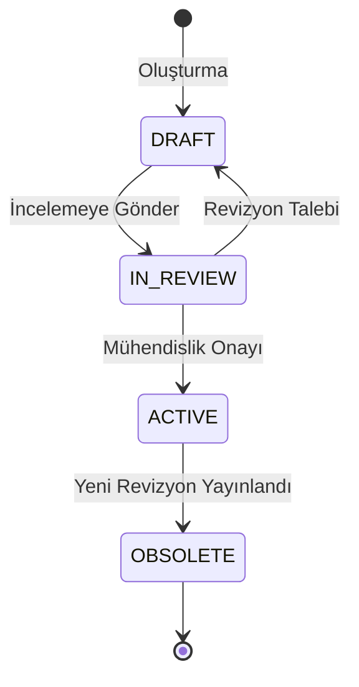
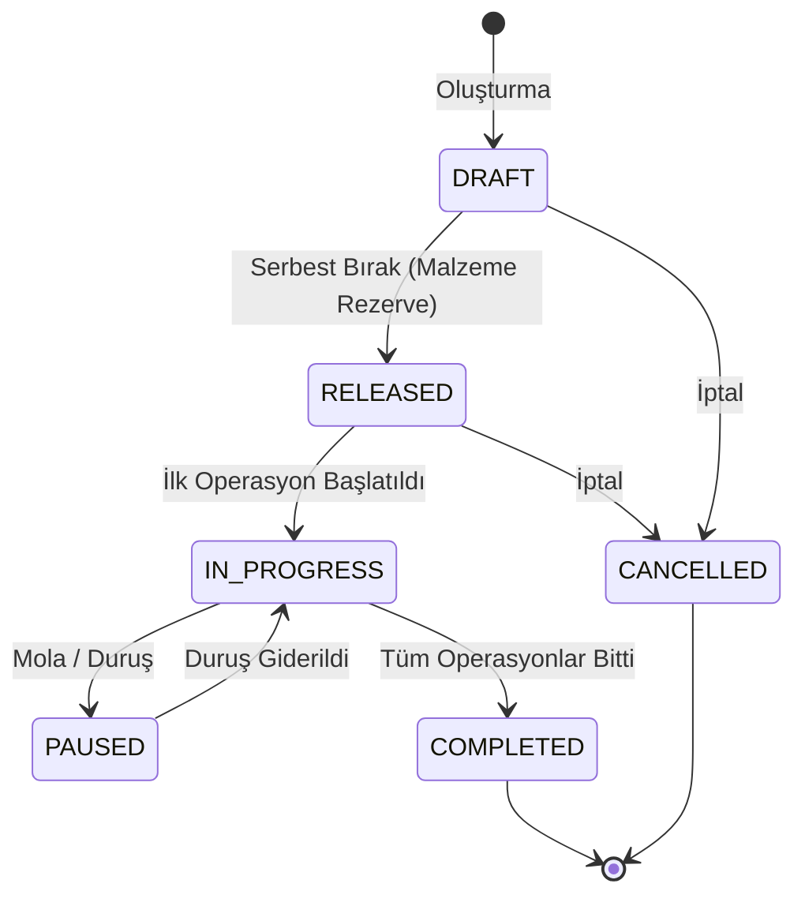
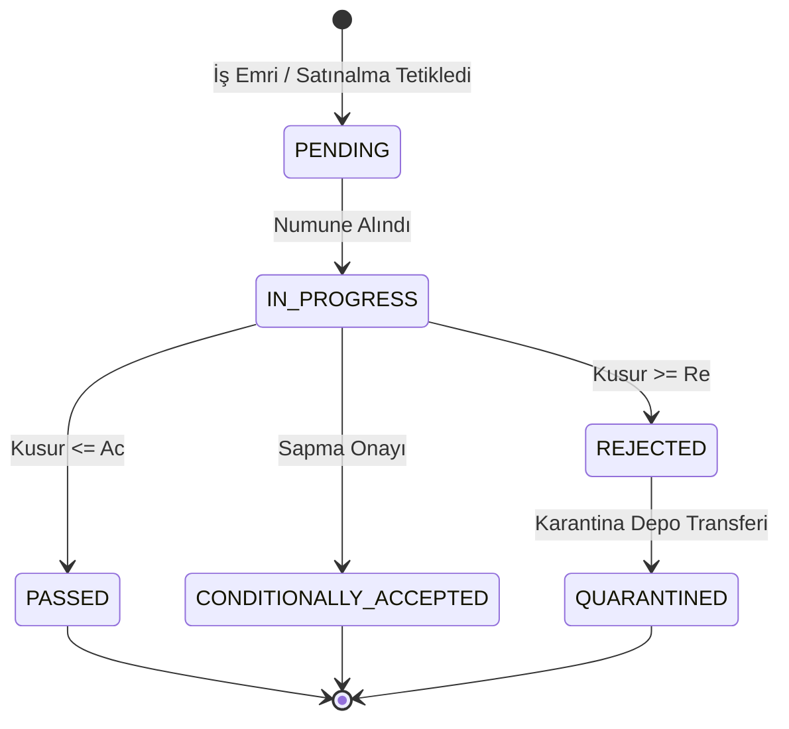
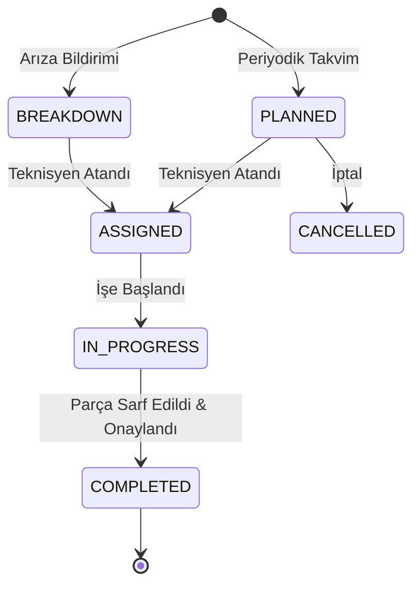

# Sunum ERP — Üretim Yönetim Sistemi Teknik Mimari Dokümanı (v1.0.0)

Bu doküman, Sunum ERP Üretim Yönetim Sistemi'nin teknik mimarisini, veri modelini, saf matematiksel hesaplama motorlarını, durum makinelerini (state machines) ve veritabanı yalıtım stratejisini detaylandırmaktadır.

---

## 1. Mimari Katmanlar ve Sistem Tasarımı

Sunum ERP Üretim Suite'i, yüksek ölçeklenebilirlik ve sıfır yan etki prensibiyle 4 katmanlı (layered architecture) olarak tasarlanmıştır:

```
┌────────────────────────────────────────────────────────────────────────┐
│                   1. KULLANICI ARAYÜZÜ (Next.js 14 App)                 │
│  - ProductionModuleReadinessView                                       │
│  - ProductionMaintenanceWorkspace                                      │
│  - ProductionConsolidatedWorkspace                                     │
│  - Zinc Paleti, Glassmorphism, Tailwind CSS, Lucide Icons              │
└────────────────────────────────────────────────────────────────────────┘
                                    │ (JSON REST Requests)
                                    ▼
┌────────────────────────────────────────────────────────────────────────┐
│                    2. API KATMANI (Route Handlers)                     │
│  - Feature Flag Bariyeri (resolveProductionFeatureFlags)                │
│  - RBAC & Oturum Doğrulama (resolveAuth, 401/403)                      │
│  - Zod ile Girdi Doğrulama ve Tip Güvenliği                             │
│  - Hata Yakalama ve Standartlaştırılmış JSON Yanıtı                    │
└────────────────────────────────────────────────────────────────────────┘
                                    │
                                    ▼
┌────────────────────────────────────────────────────────────────────────┐
│             3. SAF MATEMATİKSEL MOTORLAR & SERVİSLER                   │
│  - productionMrpMpsEngine: LLC, Net İhtiyaç, EOQ/FOQ/L4L Lotlama       │
│  - productionCapacityEngine: Sonlu/Sonsuz Çizelgeleme, CTP, CR        │
│  - productionQualityEngine: ISO 2859-1 AQL Örnekleme Tabloları        │
│  - productionMaintenanceEngine: MTBF, MTTR, OEE, Kestirimci Eşikler    │
│  - Sıfır Harici DB Bağımlılığı (Pure TypeScript / Direct Unit Testable)│
└────────────────────────────────────────────────────────────────────────┘
                                    │
                                    ▼
┌────────────────────────────────────────────────────────────────────────┐
│             4. VERİ ERİŞİM & DAYANIKLILIK KATMANI (Prisma + Fallback)  │
│  - PostgreSQL (Prisma ORM, İndeksler ve İlişkisel Bütünlük)            │
│  - DevResilience Motoru (P1001 Offline durumunda .local-db.json)       │
│  - Katkı Sağlayıcı (Additive) Migration Stratejisi                     │
└────────────────────────────────────────────────────────────────────────┘
```

---

## 2. Saf Matematiksel Hesaplama Motorları

Tüm iş kuralları ve algoritmik hesaplamalar veritabanından tamamen izole edilmiş saf fonksiyonlar (pure functions) halinde kodlanmıştır.

### 2.1 Düşük Seviye Kodu (Low-Level Coding - LLC) Algoritması
Çok seviyeli ürün reçetelerinde (BOM) döngüsel bağımlılıkları (circular dependency) tespit etmek ve patlatma sırasını belirlemek için topolojik sıralama kullanılır:
- En üst mamul seviyesi: `LLC = 0`
- Her bir alt bileşen: `LLC = max(mevcut_LLC, parent_LLC + 1)`
- Döngü (cycle) tespit edildiğinde `ProductionDomainError("BOM döngüsel bağımlılık içeriyor")` fırlatılır.

### 2.2 Malzeme İhtiyaç Planlaması (MRP) Motoru
- **Net İhtiyaç Formülü:**
  $$\text{Net İhtiyaç} = \max\Big(0, \text{Brüt Talep} + \text{Güvenlik Stoğu} - (\text{Eldeki Stok} + \text{Planlanan Girişler} - \text{Rezerve Stok})\Big)$$
- **Lot Büyüklüğü Kuralları:**
  - **L4L (Lot-for-Lot):** $\text{Sipariş Miktarı} = \text{Net İhtiyaç}$
  - **FOQ (Fixed Order Quantity):** $\text{Sipariş Miktarı} = \lceil\frac{\text{Net İhtiyaç}}{\text{Sabit Lot}}\rceil \times \text{Sabit Lot}$
  - **EOQ (Ekonomik Sipariş Miktarı):**
    $$\text{EOQ} = \sqrt{\frac{2 \times D \times S}{H}}$$
    *(D: Yıllık Talep, S: Sipariş Başı Sabit Maliyet, H: Yıllık Birim Elde Tutma Maliyeti)*

### 2.3 Kapasite Planlama & Çizelgeleme Motoru
- **Kritik Oran (Critical Ratio - CR) Öncelik Formülü:**
  $$\text{CR} = \frac{\text{Teslimat Tarihine Kalan Süre}}{\text{Gerekli Kalan İşlem Süresi}}$$
  - $CR < 1.0$: Gecikme riski yüksek, acil operasyon.
  - $CR = 1.0$: Tam zamanında.
  - $CR > 1.0$: Güvenli aralık.
- **Sonlu Kapasite Çizelgeleme (Finite Scheduling):**
  - İstasyon çalışma takvimi, resmi tatiller, vardiya süreleri ve bakım duruşları düşülerek net kapasite hesaplanır.
  - Operasyonlar makine timeline'ında çakışma olmaksızın sıralanır.
  - Kilitli (Pinned) operasyonların zamanı sabit tutulur, kilitli olmayanlar etrafına yerleştirilir.

### 2.4 ISO 2859-1 AQL Örnekleme Tablosu
- Parti büyüklüğüne ($N$) ve Muayene Seviyesine ($S_1-S_4, I, II, III$) göre numune büyüklüğü ($n$) belirlenir.
- Kabul Sayısı ($Ac$) ve Ret Sayısı ($Re$):
  - Kusurlu Sayısı $\le Ac \implies$ **KABUL**
  - Kusurlu Sayısı $\ge Re \implies$ **RET**

### 2.5 Güvenilirlik ve Bakım Matematiği (MTBF, MTTR, OEE)
- **MTBF (Ortalama Arızalar Arası Süre):**
  $$\text{MTBF} = \frac{\text{Toplam Çalışma Süresi (Dakika)}}{\text{Arıza Sayısı}}$$
- **MTTR (Ortalama Onarım Süresi):**
  $$\text{MTTR} = \frac{\text{Toplam Arıza Duruş Süresi (Dakika)}}{\text{Arıza Sayısı}}$$
- **OEE (Overall Equipment Effectiveness):**
  $$\text{OEE} = \text{Kullanılabilirlik (A)} \times \text{Performans (P)} \times \text{Kalite (Q)}$$
  $$\text{Kullanılabilirlik} = \frac{\text{Planlanan Çalışma Süresi} - \text{Duruş Süresi}}{\text{Planlanan Çalışma Süresi}}$$
  $$\text{Performans} = \frac{\text{Toplam Üretilen Miktar} \times \text{İdeal Döngü Süresi}}{\text{Çalışma Süresi}}$$
  $$\text{Kalite} = \frac{\text{Sağlam Üretilen Miktar}}{\text{Toplam Üretilen Miktar}}$$

---

## 3. Durum Makineleri (State Machines)

Üretim nesneleri, geçersiz durum geçişlerini önleyen katı durum makinelerine tabidir:

### 3.1 Ürün Reçetesi (BOM)


### 3.2 İş Emri (Work Order)


### 3.3 Kalite Muayenesi (Inspection)


### 3.4 Bakım İş Emri (Maintenance Work Order)


---

## 4. Veri Modeli ve İndeks Mimarisi

Tüm üretim tabloları `Uretim` ön ekiyle adlandırılmış olup mevcut çekirdek tablolara (User, InventoryItem vb.) yalnızca additive yabancı anahtarlarla (foreign keys) bağlanmıştır.

### Kritik İndeks Yapısı:
- `UretimWorkOrderOperation`: `@@index([workOrderId])`, `@@index([workCenterId])`
- `UretimMaintenanceWorkOrder`: `@@index([machineAssetId])`, `@@index([status])`
- `UretimQualityInspection`: `@@index([inspectionId])`, `@@index([workOrderId])`
- `UretimMaintenancePlanChecklist`: `@@index([planId])`
- `UretimIntegrationAuditLog`: `@@index([eventType])`, `@@index([userId, createdAt])`

Bu indeksler sayesinde yüksek hacimli sorgularda full table scan engellenmiş ve API yanıt süreleri optimize edilmiştir.

